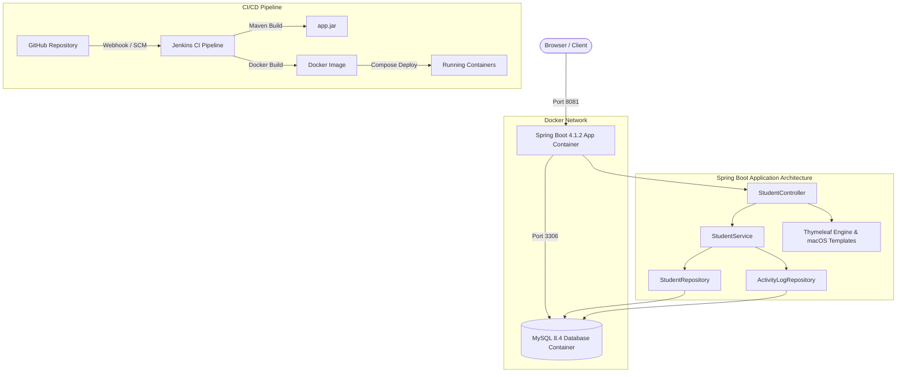

# 🎓 Student Management Pro — DevOps & Modern Dashboard

[](https://openjdk.org/)
[](https://spring.io/projects/spring-boot)
[](https://www.mysql.com/)
[](https://www.docker.com/)
[](https://docs.docker.com/compose/)
[](https://www.jenkins.io/)
[](https://developer.apple.com/design/human-interface-guidelines/)

A commercial-grade **Student Management Dashboard** built with **Java 21**, **Spring Boot**, **MySQL 8.4**, and **DevOps automation** (Docker, Docker Compose, and Jenkins CI). 

The user interface follows the **Apple Human Interface Guidelines (macOS Sequoia / Sonoma)**, combining elegant glassmorphism, SF Pro typography, refined animations, and an authentic desktop experience with robust backend persistence and data management.

---

## 🌟 Key Highlights & Features

### 🖥️ 1. macOS-Inspired Interface Design
- **macOS Window Frame & Traffic Lights**: Working red (close), amber (minimize), and green (zoom/fullscreen) window controls.
- **Translucent Frosted Glass Surfaces**: Backdrop blur effects (`backdrop-filter: blur(25px)`), subtle drop shadows, and clean borders.
- **System Typography & Apple Color Palette**: SF Pro font stack with Apple Blue (`#0071e3`), Emerald Green (`#34c759`), and Accent Purple (`#af52de`).
- **Dark / Light Mode**: Seamless theme switcher with live icon changes and `localStorage` state persistence.
- **Collapsible Sidebar**: Compact icon-only view or expanded full navigation menu with live database connection telemetry.

### 📊 2. Dynamic Dashboard Overview
- **Real-Time Database Statistics**:
  - **Total Enrolled Students**: Live count from MySQL.
  - **Academic Departments**: Distinct active programs count.
  - **New This Month**: Number of students enrolled in the current calendar month.
  - **System Node Health**: Real-time server and database engine status.
- **Department Distribution Chart**: Interactive Chart.js Donut Chart with percentage breakdown and automatic SVG fallback for offline environments.
- **Persistent Activity Audit Stream**: Real audit events recorded directly into MySQL (`activity_logs` table) upon student creation, update, deletion, bulk deletion, and CSV import.
- **Recent Enrolments Preview**: Quick-access preview cards for the latest student entries.

### 🧑‍🎓 3. Comprehensive Student Management
- **Modern Student Directory Table**:
  - Dynamic initials avatars styled with a curated Apple pastel color palette.
  - Student legal name with monospace ID tag.
  - Email address with clipboard copy button.
  - Department badge pills.
  - Formatted enrollment date tracking.
- **Instant Live Search**: Client-side filtering across student name, email, and department in real time.
- **Department Filter**: Dropdown dynamically populated with distinct courses from the database.
- **Multi-Option Sorting**: Sort by Newest First, Oldest First, Name (A–Z), Name (Z–A), and Department.
- **Configurable Pagination**: Page sizes (10, 25, 50, Show All) with responsive pagination pills.
- **Modal Sheets**:
  - **Enroll Student Modal**: In-place macOS modal with real-time validation and department suggestions.
  - **Edit Student Modal**: In-place pre-populated modal (while preserving the standalone `/students/edit/{id}` page).
  - **Student Profile Inspector**: Detailed modal with full academic profile and quick actions.
  - **Delete Confirmation Modal**: Custom macOS destructive warning sheet with confirmation before deletion.
- **Multi-Select & Bulk Actions**: Checkbox selection for multiple students, counter badge (`"N students selected"`), and atomic bulk deletion.

### 📁 4. CSV Import & Export Utilities
- **RFC 4180-Compliant CSV Export**: One-click download of the entire student directory with UTF-8 BOM encoding for complete compatibility with Microsoft Excel, Apple Numbers, and Google Sheets.
- **Batch CSV Import**: File dropzone for batch uploading students (`Name, Email, Department, Registration Date`). Validates email format, prevents duplicate database entries, and generates detailed toast summaries.

### 📝 5. Validation, Notifications & Print Reports
- **Inline Validation**: Instant visual feedback (name min length >= 2, strict RFC email regex, required department).
- **macOS Floating Toasts**: Auto-dismissing alerts for success, validation, and error messages.
- **Printable Student Roster**: `@media print` formatted view that hides UI chrome, producing clean official student documents for physical print or PDF saving.

---

## 🏛️ System Architecture



---

## 💻 Technology Stack

| Layer | Technologies |
| :--- | :--- |
| **Backend** | Java 21, Spring Boot 4.1.2, Spring Data JPA, Hibernate ORM |
| **Database** | MySQL 8.4 Community Edition |
| **Frontend** | Thymeleaf 3.x, HTML5, Vanilla JavaScript (ES6+), CSS3 (macOS Design Tokens), Chart.js |
| **DevOps & Containers** | Docker, Docker Compose, Eclipse Temurin 21 JRE Base Image |
| **CI / CD** | Git, GitHub, Jenkins Pipeline |
| **Build Tool** | Apache Maven 3.9+ |

---

## 📂 Project Directory Structure

```text
demo/
├── .env                                  # Environment secrets for Docker Compose
├── .gitignore                            # Git ignore rules
├── Dockerfile                            # Production Eclipse Temurin 21 JRE image
├── docker-compose.yml                    # Multi-container orchestration (App + MySQL)
├── pom.xml                               # Maven project definition and dependencies
└── src/
    ├── main/
    │   ├── java/com/example/demo/
    │   │   ├── DemoApplication.java      # Spring Boot application entrypoint
    │   │   ├── controller/
    │   │   │   └── StudentController.java# Web & API endpoints controller
    │   │   ├── model/
    │   │   │   ├── Student.java          # Student JPA entity
    │   │   │   └── ActivityLog.java      # Activity audit log JPA entity
    │   │   ├── repository/
    │   │   │   ├── StudentRepository.java# Student database repository
    │   │   │   └── ActivityLogRepository.java # Activity audit repository
    │   │   └── service/
    │   │       └── StudentService.java   # Business logic, CSV import/export, audit
    │   └── resources/
    │       ├── application.properties    # Local development database configuration
    │       ├── application-docker.properties # Containerized database configuration
    │       ├── static/
    │       │   ├── css/
    │       │   │   └── macos-dashboard.css # macOS Sequoia/Sonoma design system
    │       │   └── js/
    │       │       └── macos-dashboard.js  # Interactive UI & table controller
    │       └── templates/
    │           ├── index.html            # Primary macOS Dashboard view
    │           └── edit.html             # Standalone student edit view
    └── test/                             # Unit and integration test suites
```

---

## 🚀 Getting Started

### Prerequisites
- [Java 21 JDK](https://www.oracle.com/java/technologies/downloads/#java21)
- [Apache Maven 3.9+](https://maven.apache.org/)
- [Docker Desktop](https://www.docker.com/products/docker-desktop/) (for containerized execution)
- [Git](https://git-scm.com/)

---

### Option 1: Running with Docker Compose (Recommended)

1. **Clone the repository:**
   ```bash
   git clone https://github.com/Mohammad23chandini/Student-Management-DevOps.git
   cd Student-Management-DevOps/demo
   ```

2. **Package the application JAR:**
   ```bash
   mvn package -DskipTests
   ```

3. **Start the containers via Docker Compose:**
   ```bash
   docker compose up -d --build
   ```

4. **Verify running containers:**
   ```bash
   docker compose ps
   ```
   - `student-management-app`: Listening on `http://localhost:8081`
   - `student-mysql`: Listening on `localhost:3307` (forwarded to internal 3306)

5. **Open your browser and navigate to:**
   ```text
   http://localhost:8081
   ```

---

### Option 2: Running Locally with Maven

1. **Start a local MySQL 8.4 instance** and create the database:
   ```sql
   CREATE DATABASE student_management;
   ```

2. **Verify `src/main/resources/application.properties` credentials:**
   ```properties
   spring.datasource.url=jdbc:mysql://localhost:3306/student_management
   spring.datasource.username=root
   spring.datasource.password=your_mysql_password
   server.port=8081
   ```

3. **Compile and run the Spring Boot application:**
   ```bash
   mvn clean spring-boot:run
   ```

4. **Access the application at:** `http://localhost:8081`

---

## 📡 REST API & Web Routes Reference

| HTTP Method | Route | Description |
| :--- | :--- | :--- |
| `GET` | `/` | Dashboard Overview with KPIs, Charts & Activity Feed |
| `GET` | `/students` | All Students Directory with Table, Search & Filters |
| `POST` | `/students` | Enroll a new student record (with validation) |
| `GET` | `/students/edit/{id}` | Standalone edit page for a specific student |
| `POST` | `/students/update/{id}` | Update existing student record |
| `GET` | `/students/delete/{id}` | Delete a student record by ID |
| `POST` | `/students/bulk-delete` | Batch delete selected student IDs |
| `GET` | `/students/export` | Download full RFC 4180-compliant CSV export |
| `POST` | `/students/import` | Upload & import student records from CSV file |
| `GET` | `/analytics` | Academic department breakdown and analytics view |
| `GET` | `/reports` | CSV management and printable roster reports view |
| `GET` | `/settings` | System tech stack runtime metadata & theme config |
| `GET` | `/api/stats` | JSON endpoint returning live counts & department distribution |
| `GET` | `/api/students/{id}` | JSON endpoint returning individual student data |
| `POST` | `/students/seed-demo` | Seeds realistic multi-department demonstration records |

---

## 🗄️ Database Schema Evolution

Hibernate automatically synchronizes the MySQL database schema using `spring.jpa.hibernate.ddl-auto=update`.

### 1. `students` Table
| Column | Type | Constraints | Description |
| :--- | :--- | :--- | :--- |
| `id` | `BIGINT` | PRIMARY KEY, AUTO_INCREMENT | Unique student identifier |
| `name` | `VARCHAR(255)` | NOT NULL | Legal student full name |
| `email` | `VARCHAR(255)` | NOT NULL, UNIQUE | Campus or personal email |
| `course` | `VARCHAR(255)` | NOT NULL | Department / Course enrolled |
| `registration_date` | `DATE` | NULL | Date of enrollment |

### 2. `activity_logs` Table
| Column | Type | Constraints | Description |
| :--- | :--- | :--- | :--- |
| `id` | `BIGINT` | PRIMARY KEY, AUTO_INCREMENT | Unique audit log identifier |
| `action` | `VARCHAR(255)` | NOT NULL | Action type (`CREATE`, `UPDATE`, `DELETE`, `BULK_DELETE`, `IMPORT`) |
| `description` | `VARCHAR(500)` | NOT NULL | Human-readable event description |
| `student_name` | `VARCHAR(255)` | NULL | Associated student reference |
| `timestamp` | `DATETIME(6)` | NOT NULL | Exact system timestamp of event |

---

## 🔄 DevOps & CI/CD with Jenkins

The project includes ready-to-run configurations for Jenkins CI pipelines:

```groovy
pipeline {
    agent any

    tools {
        maven 'Maven-3.9.16'
        jdk 'JDK-21'
    }

    stages {
        stage('Checkout Source') {
            steps {
                git branch: 'main', url: 'https://github.com/Mohammad23chandini/Student-Management-DevOps.git'
            }
        }

        stage('Build & Test') {
            steps {
                dir('demo') {
                    sh 'mvn clean package -DskipTests'
                }
            }
        }

        stage('Docker Build & Deploy') {
            steps {
                dir('demo') {
                    sh 'docker compose down'
                    sh 'docker compose up -d --build'
                }
            }
        }
    }
}
```

---

## 🛡️ Security & Best Practices

- **Zero Hardcoded Secrets**: Database credentials in Docker Compose are injected via environment variables (`${MYSQL_ROOT_PASSWORD}`) through `.env`.
- **Input Sanitization**: CSV parser strictly escapes quotes and prevents CSV injection vulnerabilities.
- **SQL Injection Prevention**: Built entirely on Spring Data JPA parameterized queries and Criteria API.
- **Transactional Integrity**: Bulk operations and imports execute in managed Spring `@Transactional` contexts to guarantee all-or-nothing atomicity.

---

## 📄 License
This project is open-source and available under the [MIT License](LICENSE).
