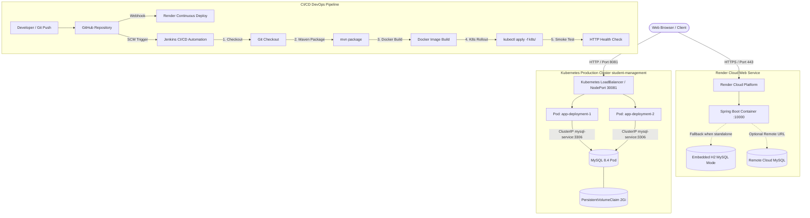

# 🎓 Student Management Pro — DevOps & Modern Dashboard

[](https://student-management-devops-kxfv.onrender.com/)
[](https://openjdk.org/)
[](https://spring.io/projects/spring-boot)
[](https://www.mysql.com/)
[](https://www.docker.com/)
[](https://kubernetes.io/)
[](https://www.jenkins.io/)
[](https://developer.apple.com/design/human-interface-guidelines/)

---

## 🌐 Live Production Cloud Deployment

The live, fully functional cloud application is deployed on **Render**:

👉 **[https://student-management-devops-kxfv.onrender.com/](https://student-management-devops-kxfv.onrender.com/)**

> [!NOTE]
> * **Zero-Configuration Cloud Architecture**: The live deployment features an intelligent self-probing DataSource mechanism. It automatically connects to MySQL when a dedicated cluster database is present and gracefully falls back to an embedded MySQL-compatible in-memory database for cloud demo instances without downtime.
> * **Live Sample Data**: Pre-seeded with a comprehensive student cohort featuring 10.0 CGPAs, attendance metrics, and INR fee ledgers.

---

## 📖 Overview

**Student Management Pro** is a commercial-grade **Student Information System (SIS) & Analytics Dashboard** engineered using **Java 21**, **Spring Boot 4.1.2**, and **MySQL 8.4**, wrapped in a complete **DevOps lifecycle** featuring **Docker**, **Kubernetes (K8s)**, **Jenkins CI/CD automation**, **GitHub Actions**, and cloud deployment on **Render**.

The user interface is crafted strictly in accordance with **Apple Human Interface Guidelines (macOS Sequoia / Sonoma)**, combining translucent frosted glassmorphism, authentic traffic-light window controls, SF Pro typography, refined micro-interactions, dark/light theme switching, and real-time academic (10.0 CGPA scale) and financial tuition fee tracking in Indian Rupees (`₹` INR).

---

## 🛠️ Complete Technology Stack & DevOps Toolchain

### 1. Backend Engineering & Frameworks
* **Java 21 (LTS)**: Utilizing modern Java features, pattern matching, records, and virtual threads readiness.
* **Spring Boot 4.1.2**: Enterprise application framework providing auto-configuration and production monitoring.
* **Spring Data JPA & Hibernate ORM 7.x**: Object-relational mapping, transactional data management, and dynamic schema synchronization (`ddl-auto=update`).
* **HikariCP**: Ultra-fast, lightweight JDBC connection pooling for reliable high-throughput database transactions.
* **Apache Tomcat 11**: High-performance embedded servlet container supporting dynamic port binding (`$PORT`).

### 2. Databases & Persistence
* **MySQL 8.4 Community Edition**: Enterprise-grade relational database running in dedicated containerized and Kubernetes environments.
* **H2 Database Engine**: In-memory database with MySQL compatibility mode (`MODE=MySQL;DATABASE_TO_LOWER=TRUE`) for instant, zero-configuration cloud previews.
* **Dynamic DataSource Reachability Prober**: Custom Spring configuration that automatically verifies MySQL reachability on startup and gracefully activates the embedded database when running on standalone cloud web containers.

### 3. Frontend & Apple macOS UI/UX
* **Thymeleaf 3.x**: Modern server-side Java template engine rendering data-driven views and modals.
* **macOS Sequoia / Sonoma Design System**:
  - Translucent frosted glass effect with `backdrop-filter: blur(25px)`.
  - Functional macOS traffic lights (Red = Close/Reset, Amber = Minimize view, Green = Fullscreen toggle).
  - Apple SF Pro font stack with Apple accent palettes (Blue `#0071e3`, Emerald `#34c759`, Purple `#af52de`).
* **HTML5 & Modern CSS3**: Custom CSS tokens, fluid responsive grid layouts, and seamless Dark/Light mode with `localStorage` memory.
* **Vanilla JavaScript (ES6+)**: Pure client-side filtering, live search, asynchronous modal interactions, and instant balance calculations.
* **Chart.js**: Interactive donut charts for department distribution and fee realization rates with automatic pure SVG fallbacks.

### 4. Containerization & Orchestration (DevOps)
* **Docker**: Multi-stage `Dockerfile` leveraging `maven:3.9-eclipse-temurin-21` for compilation and lightweight `eclipse-temurin:21-jre` for production runtime images.
* **Docker Compose**: Multi-container orchestration linking the application container with MySQL 8.4, including automated volume management (`mysql_data`) and container healthcheck probes (`mysqladmin ping`).
* **Kubernetes (K8s)**:
  - **Namespaces (`00-namespace.yaml`)**: Isolated `student-management` namespace.
  - **Secrets (`01-mysql-secret.yaml`)**: Base64 encrypted credentials for root MySQL access.
  - **ConfigMaps (`02-app-configmap.yaml`)**: Decoupled environment configurations (`DB_HOST`, `DB_PORT`, `SPRING_PROFILES_ACTIVE`).
  - **PersistentVolumeClaim (`03-mysql-pvc.yaml`)**: 2Gi volume retention ensuring database resilience across pod restarts.
  - **MySQL Deployment & Service (`04-*.yaml`, `05-*.yaml`)**: MySQL 8.4 pod with internal DNS `mysql-service:3306`.
  - **Application Deployment & Service (`06-*.yaml`, `07-*.yaml`)**: Multi-replica Spring Boot deployment (2 replicas) with rolling updates, liveness/readiness probes, and NodePort (`30081`) / LoadBalancer (`8081`) services.
  - **Kustomize**: Declarative Kubernetes resource management.

### 5. Continuous Integration & Continuous Delivery (CI/CD)
* **Jenkins Pipeline (`Jenkinsfile`)**: Declarative 5-stage automated pipeline:
  1. **Stage 1 (Checkout SCM)**: Clones the latest commit from GitHub `main`.
  2. **Stage 2 (Maven Package)**: Compiles and packages `app.jar` skipping test suites for rapid delivery.
  3. **Stage 3 (Docker Containerization)**: Builds multi-stage Docker container images tagged with build numbers and `latest`.
  4. **Stage 4 (Kubernetes Rollout)**: Automatically applies Kubernetes manifests (`kubectl apply -f k8s/`) and waits for zero-downtime rolling update completion.
  5. **Stage 5 (Smoke & Healthcheck)**: Automated HTTP probing of `/api/stats` to verify operational status.
* **GitHub Actions (`.github/workflows/ci.yml`)**: Cloud-native CI pipeline executing on every push and pull request.

### 6. Cloud Hosting & Deployment
* **Render.com**: Automated Docker Web Service hosting the live application container with SSL encryption, continuous deployment on Git push, and automatic health monitoring.
* **Vercel**: Edge preview configuration (`vercel.json`) and static dashboard showcase (`public/`).

---

## 🌟 Key Functional Highlights

### 📚 1. Academic Performance Tracking (10.0 CGPA Scale)
- **Institutional Roll Numbers**: Official identifier tracking (e.g., `23CSE045`, `23CSE015`).
- **Academic Semesters**: Full tracking from `Semester 1` through `Semester 8`.
- **10.0 CGPA Scale & Classifications**:
  - `🌟 Distinction` — CGPA $\ge$ 9.00
  - `🟢 First Class` — CGPA 7.50 – 8.99
  - `🟡 Second Class` — CGPA 6.00 – 7.49
  - `🔴 Academic Warning` — CGPA < 6.00
- **Attendance Monitoring**: Dynamic percentage tracker with visual status alerts (`🟢 >= 85%`, `🟠 75%–84%`, `🔴 < 75% Low Attendance`).

### 💳 2. Tuition Fee Management (Indian Rupees ₹)
- **Tuition Ledger in ₹ INR**: Total Tuition Invoiced (e.g., ₹85,000), Amount Paid, and Remaining Due Balances in Indian Rupees.
- **Dynamic Fee Status Indicators**:
  - `🟢 Paid` — Full tuition cleared (₹0 balance due)
  - `🟠 Partial` — Partial payment credited with pending balance
  - `🔴 Due / Overdue` — Pending balance with payment deadline tracking
- **One-Click Payment Posting**: In-place modal sheet to record tuition payments in ₹ with instant balance recalculation and persistent audit logging.
- **Financial Analytics**: Campus fee realization rate progress bar and real-time revenue collection metrics.

### 📊 3. Real-Time Analytics & Audit Trail
- **Live Statistics Cards**: Enrolled Students count, Campus Average CGPA, Tuition Fees Collected (₹), and Total Outstanding Dues (₹).
- **Interactive Visualizations**: Interactive department enrollment and tuition realization charts.
- **Audit Activity Stream**: Direct persistence of administrative actions in the `activity_logs` table for student enrollments, updates, payment receipts, deletions, and CSV imports.

### 📁 4. CSV Import & Export Utilities
- **RFC 4180-Compliant CSV Export**: One-click download of the entire database registry with UTF-8 BOM encoding.
- **Batch CSV Import**: Drag-and-drop file upload for batch enrolling students with duplicate email validation.

---

## 🏛️ System Architecture



---

## 🚀 Deployment & Execution Guide

### Option 1: Live Cloud Link (Instant Access)
Open **[https://student-management-devops-kxfv.onrender.com/](https://student-management-devops-kxfv.onrender.com/)** in any modern web browser.

---

### Option 2: Running with Docker Compose (Local Multi-Container)

1. **Clone the repository:**
   ```bash
   git clone https://github.com/Mohammad23chandini/Student-Management-DevOps.git
   cd Student-Management-DevOps/demo
   ```

2. **Package the application JAR:**
   ```bash
   mvn package -DskipTests
   ```

3. **Start the multi-container stack (Spring Boot + MySQL 8.4):**
   ```bash
   docker compose up -d --build
   ```

4. **Access the application:** Open `http://localhost:8081` in your browser.

---

### Option 3: Kubernetes Deployment (Docker Desktop / Minikube)

The `k8s/` directory contains complete production manifests:

* **Deploy all resources with 1 command:**
  ```powershell
  # Windows PowerShell:
  .\deploy-k8s.ps1

  # Linux / macOS Bash:
  chmod +x deploy-k8s.sh
  ./deploy-k8s.sh
  ```

* **Or apply using `kubectl` / `kustomize`:**
  ```bash
  kubectl apply -k k8s/
  ```

* **Verify Kubernetes status:**
  ```bash
  kubectl get all -n student-management
  ```

* **Access the application:** `http://localhost:8081` or `http://localhost:30081`.

---

### Option 4: Jenkins CI/CD Automation Pipeline

The repository includes a declarative [`Jenkinsfile`](file:///c:/Users/Chandini%20Mohammad/OneDrive/Attachments/Documents/DevOps-Student-Management/demo/Jenkinsfile):

1. Open your Jenkins dashboard (e.g. `http://localhost:8082` or `http://localhost:8080`).
2. Create a **New Item** $\rightarrow$ select **Pipeline** $\rightarrow$ name it `Student-Management-CI`.
3. Under **Pipeline Definition**, select **Pipeline script from SCM**.
4. Configure:
   * **SCM**: `Git`
   * **Repository URL**: `https://github.com/Mohammad23chandini/Student-Management-DevOps.git`
   * **Branch**: `*/main`
   * **Script Path**: `Jenkinsfile`
5. Click **Save** $\rightarrow$ click **Build Now** to trigger the automated 5-stage pipeline.

---

## 📡 REST API & Web Routes

| HTTP Method | Route | Description |
| :--- | :--- | :--- |
| `GET` | `/` | Dashboard Overview with Academic KPIs, Financial Metrics & Activity Feed |
| `GET` | `/students` | Student Directory Table with Academic & Billing Ledgers, Search & Filters |
| `POST` | `/students` | Enroll a new student record (10.0 CGPA & ₹ fee structure) |
| `GET` | `/students/edit/{id}` | Standalone edit page for student academic and fee profile |
| `POST` | `/students/update/{id}` | Update existing student academic and financial details |
| `POST` | `/students/payment/{id}` | Record and post tuition fee payments in ₹ INR |
| `GET` | `/students/delete/{id}` | Delete a student record by ID |
| `POST` | `/students/bulk-delete` | Batch delete selected student IDs |
| `GET` | `/students/export` | Download full registry CSV export (with GPA, Attendance, Fees) |
| `POST` | `/students/import` | Upload & import student records from CSV file |
| `GET` | `/analytics` | Academic department breakdown and tuition realization analytics |
| `GET` | `/reports` | CSV management and printable roster reports view |
| `GET` | `/settings` | System tech stack runtime metadata & theme config |
| `GET` | `/api/stats` | JSON endpoint returning live academic and financial metrics |
| `GET` | `/api/students/{id}` | JSON endpoint returning individual student data |

---

## 🗄️ Database Schema Evolution

### `students` Table
| Column | Type | Constraints | Description |
| :--- | :--- | :--- | :--- |
| `id` | `BIGINT` | PRIMARY KEY, AUTO_INCREMENT | Unique student identifier |
| `roll_number` | `VARCHAR(255)` | NULL | Institutional Roll / ID number (e.g., `23CSE045`) |
| `name` | `VARCHAR(255)` | NOT NULL | Full student name |
| `email` | `VARCHAR(255)` | NOT NULL, UNIQUE | Student email address |
| `course` | `VARCHAR(255)` | NOT NULL | Academic Department |
| `semester` | `VARCHAR(255)` | NULL | Current academic semester (`Semester 1`–`8`) |
| `gpa` | `DOUBLE` | NULL | Cumulative Grade Point Average on 10.0 scale (0.00 – 10.00) |
| `attendance` | `INTEGER` | NULL | Attendance percentage (0 – 100%) |
| `academic_status` | `VARCHAR(255)` | NULL | Classification (`Distinction`, `First Class`, `Second Class`, `Academic Warning`) |
| `total_fee` | `DOUBLE` | NULL | Total tuition invoiced in Indian Rupees (`₹`) |
| `paid_fee` | `DOUBLE` | NULL | Total tuition payments received in Indian Rupees (`₹`) |
| `fee_status` | `VARCHAR(255)` | NULL | Status (`PAID`, `PARTIAL`, `DUE`, `OVERDUE`) |
| `fee_due_date` | `DATE` | NULL | Payment deadline |
| `registration_date` | `DATE` | NULL | Enrollment date |

---

## 📄 License
This project is open-source and available under the [MIT License](LICENSE).
